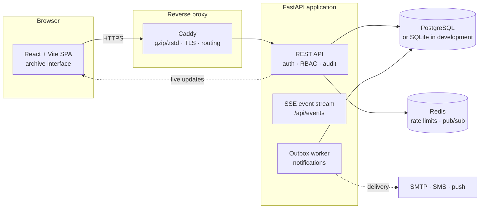
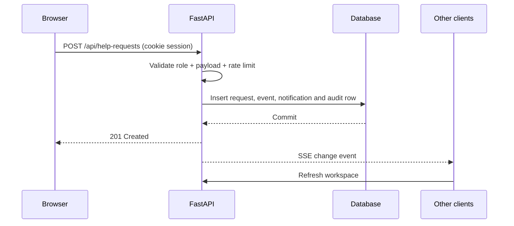

<div align="center">

<h1>ResQSync</h1>
<p><strong>Every resource where it matters.</strong></p>

<p>
A crisis-resource coordination platform for India's emergency response networks.<br/>
Incidents, shared inventory, allocation conflicts, role-based workspaces, a help-request desk,
live updates, analytics and a complete audit trail — in one server-backed app.
</p>

<p>
  <a href="https://github.com/Abishrii/Crisis-Resource-Conflict-Resolution-Platform/actions/workflows/ci.yml">
    
  </a>
  
  
  
  
  
  
  
</p>

<p>
  <a href="#quick-start">Quick start</a> ·
  <a href="#screenshots">Screenshots</a> ·
  <a href="#faculty-demo-guide">Faculty demo</a> ·
  <a href="#architecture">Architecture</a> ·
  <a href="#api-overview">API</a> ·
  <a href="#troubleshooting">Troubleshooting</a>
</p>

</div>

---

> **Academic project.** ResQSync was built for a college evaluation. Every incident, person,
> organisation and resource in the seeded dataset is **fictional**. Demo mode is deliberately
> available in development and is hard-disabled in production.

## Why ResQSync

In a real response network, three incidents can need the same ambulance, the same boat or the same
oxygen pool at the same time. Someone has to decide who gets it first — and be able to explain why.

ResQSync turns that problem into a shared workspace:

- **One picture of the response** — incidents, resources, requests, messages and decisions in one place.
- **Transparent conflict resolution** — competing demands are ranked by severity and response readiness,
  with manager overrides that require a recorded reason.
- **A role for everyone** — administrators, crisis managers, resource coordinators and help seekers each
  get a workspace that matches what they are allowed to do.
- **Server-enforced rules** — the browser greys out controls, but every permission is checked again by
  the API. The UI is never the security boundary.
- **A live desk** — new requests and updates appear for other signed-in users without a refresh.

## Screenshots

<table>
  <tr>
    <td width="50%">
      
      <br><sub><b>Sign in · light mode</b> — one-click demo roles with capability hints</sub>
    </td>
    <td width="50%">
      
      <br><sub><b>Sign in · dark mode</b> — the same editorial interface, token-driven</sub>
    </td>
  </tr>
  <tr>
    <td width="50%">
      
      <br><sub><b>Admin workspace</b> — demo-mode chip and instant role switcher in the header</sub>
    </td>
    <td width="50%">
      
      <br><sub><b>Help-seeker desk</b> — raise a request and follow it to resolution</sub>
    </td>
  </tr>
</table>

<p align="center">
  
  <br><sub><b>Mobile sign-in</b> — the direct-access cards stack cleanly at 390 px</sub>
</p>

## Features

### The seven-module workspace

| # | Module | What it does |
|---|--------|--------------|
| **01** | 🚨 **Crisis management** | Create and track incidents, severity, location, timeline and status. |
| **02** | 📦 **Resource management** | Shared inventory for personnel, equipment, supplies and facilities, with capacity and maintenance. |
| **03** | ⚖️ **Conflict resolution** | Detects pools where demand exceeds free stock and ranks competing incidents transparently. |
| **04** | 👥 **People and access** | User administration, role assignment, account status and a role-capability matrix. |
| **05** | 💬 **Communication** | Incident channel messages, comment threads, files and in-app notifications. |
| **06** | 📊 **Analytics and reporting** | Calculated metrics, utilisation, response time, trends and PDF/XML/CSV exports. |
| **07** | 🧭 **Decision support** | Scenario simulation, coverage analysis and saved scenarios for the audit trail. |

### Beyond the modules

| Capability | Description |
|---|---|
| **Help-request desk** | A separate help-seeker workflow: `opened → verified → assigned → en route → resolved`, with photo verification and duplicate detection. |
| **Role-based workspaces** | Admin, crisis manager, resource coordinator and help seeker each land on the workspace that matches their permissions. |
| **Server-side RBAC** | A single permission table in `backend/app/roles.py` is enforced on every endpoint. |
| **Live updates** | Server-Sent Events keep every signed-in screen in sync when anything changes. |
| **Audit trail** | Sign-ins, role changes, allocations, overrides, privacy actions and demo sign-ins are recorded. |
| **Privacy and governance** | Data export, self-deletion, admin anonymisation and a configurable retention pass. |
| **Transactional outbox** | External notifications are queued, retried with backoff and marked `not_configured` when a provider is absent. |
| **Demo mode** | One-click role cards and an in-workspace role switcher for evaluation — development only. |

## Roles and permissions

| Capability | Admin | Crisis manager | Resource coordinator | Help seeker |
|---|:---:|:---:|:---:|:---:|
| View incidents, resources and reports | ✅ | ✅ | ✅ | — |
| Create and update crises | ✅ | ✅ | — | — |
| Edit inventory and maintenance | ✅ | — | ✅ | — |
| Assign and allocate resources | ✅ | ✅ | ✅ | — |
| Approve or override priorities | ✅ | ✅ | — | — |
| Manage users and roles | ✅ | — | — | — |
| Review and verify help requests | ✅ | ✅ | — | — |
| Dispatch units | ✅ | — | ✅ | — |
| Raise and track own requests | ✅ | ✅ | — | ✅ |
| Messages and file attachments | ✅ | ✅ | ✅ | — |
| Full audit trail and admin outbox | ✅ | — | — | — |

The browser mirrors this table only to disable controls. The API checks it again on every request.

## Faculty demo guide

The login page is intentionally a **demo surface** in development. It shows one-click cards for each
role so a demonstration does not depend on typing credentials.

| Demo account | Role | Where it lands |
|---|---|---|
| `aditi@example.org` | Admin | Full workspace + audit trail |
| `arjun@example.org` | Crisis manager | Workspace + request desk |
| `meera@example.org` | Resource coordinator | Workspace + dispatch queue |
| `seeker@example.org` | Help seeker | Request desk |

The manual-login password for all demo accounts is **`Resqsync#2026`**.

### A suggested five-minute walkthrough

1. **Sign in as Admin** using the first direct-access card. Show the overview, the incident board,
   the resource pools and the audit trail.
2. **Switch to Crisis Manager** from the **Demo role** dropdown in the workspace header. Verify an
   incoming help request and approve an allocation.
3. **Switch to Resource Coordinator** and show the dispatch queue, inventory and stock movements.
4. **Switch to Help Seeker**. Raise a request, then track it through `verified → assigned → en route → resolved`.
5. **Switch back to Admin** and show the audit entries created by the demonstration, including the
   `Signed in (demo)` records.

The **DEMO MODE** chip in the workspace header makes it clear that these are evaluation controls. In
production, `DEMO_LOGIN=false` hard-disables both the endpoint and the cards.

## Architecture



- **Development** uses SQLite and needs no Redis. The in-memory rate limiter and event hub work for a
  single process.
- **Deployment** uses PostgreSQL and Redis behind Caddy. Redis coordinates login throttling and live
  updates across workers.
- **The browser never talks to the database.** Every read and write goes through the API, which applies
  the permission table, commits transactionally and writes an audit record.

### Request lifecycle



## Quick start

### Prerequisites

| Tool | Version |
|---|---|
| Python | 3.12+ |
| Node.js | 20+ |
| npm | 10+ |
| Docker + Docker Compose | Optional, for the container stack |

### 1. Start the backend

```bash
cd backend
python -m venv .venv
source .venv/bin/activate          # Windows: .venv\Scripts\activate
pip install -r requirements.txt
cp .env.example .env               # optional in development; defaults work
uvicorn app.main:app --reload --port 8000
```

On the first start, `backend/resqsync.db` is created and filled with the fictional training dataset and
the demo accounts. Interactive API docs are at <http://localhost:8000/docs>.

### 2. Start the frontend

```bash
cd frontend
npm ci
npm run dev
```

Open <http://localhost:5173>. Vite proxies `/api` and `/health` to `127.0.0.1:8000`, so the HTTP-only
session cookie works without CORS.

### 3. Or run everything from one server

```bash
cd frontend
npm ci
npm run build

cd ../backend
uvicorn app.main:app --host 0.0.0.0 --port 8000
```

FastAPI serves `frontend/dist` and the API from the same origin. Open <http://127.0.0.1:8000>.

> **Resetting the demo database:** delete `backend/resqsync.db` and restart the backend. The seed is
> idempotent and recreates the fictional dataset and demo accounts. Do not delete a database that
> contains real evaluation data without taking a backup first.

## Docker deployment

The production-style stack is a multi-stage image plus four Compose services:

| Service | Purpose | Host exposure |
|---|---|---|
| `postgres` | PostgreSQL 16 with persistent storage | Not published |
| `redis` | Shared rate limits and cross-worker live updates | Not published |
| `api` | FastAPI + built frontend, non-root user | Internal `8000` only |
| `reverse-proxy` | Caddy routing, compression and optional TLS | `80` and `443` |

```bash
cp .env.example .env
# Fill in POSTGRES_PASSWORD, SECRET_KEY and the bootstrap admin credentials.

docker compose up -d --build
```

The compose file **requires** these values and fails fast if they are missing:

| Variable | Why it matters |
|---|---|
| `POSTGRES_PASSWORD` | Database credential; Postgres is not exposed to the host. |
| `SECRET_KEY` | JWT signing key. Use 32+ random characters. |
| `BOOTSTRAP_ADMIN_EMAIL` | Creates the first administrator when no admin exists. |
| `BOOTSTRAP_ADMIN_PASSWORD` | Password for that administrator. |

### HTTPS and cookies

- The default `SITE_ADDRESS=:80` serves plain HTTP. Keep `COOKIE_SECURE=false` in that mode, otherwise
  the browser will reject the session cookie.
- Set `SITE_ADDRESS=resqsync.example.org` (a real domain pointing at the host) and Caddy provisions
  HTTPS automatically. Then set `COOKIE_SECURE=true`.
- HSTS is sent automatically once a request arrives over HTTPS.

Demo mode is **off by default** in the container stack: `SEED_DEMO_DATA=false` and `DEMO_LOGIN=false`.
Use the bootstrap admin to create real staff accounts from **People & access**.

### Database migrations

PostgreSQL deployments apply Alembic migrations to `head` on startup. Manual commands:

```bash
cd backend
alembic current
alembic upgrade head
alembic revision --autogenerate -m "description_of_changes"
```

### Backups

```bash
python tools/backup.py --out ./backups
python tools/restore.py ./backups/resqsync-backup-YYYYMMDD_HHMMSS.tar.gz
python tools/test_backup_restore.py
```

A backup contains a manifest with SHA-256 checksums, engine-agnostic data, a native SQL dump and the
uploaded files.

## Configuration

Development defaults are in `backend/.env.example`; container defaults and required values are in the
root `.env.example`.

| Variable | Default | Purpose |
|---|---|---|
| `ENV` | `development` | `development`, `test` or `production`. Production requires a strong secret. |
| `SECRET_KEY` | generated in development | JWT signing key. Required in production. |
| `DATABASE_URL` | SQLite file | PostgreSQL URL for deployment. |
| `REDIS_URL` | empty | Enables shared rate limits and cross-worker events. |
| `COOKIE_SECURE` | true in production | Must match your HTTP/HTTPS setup. |
| `SEED_DEMO_DATA` | true in development | Seeds the fictional dataset and demo accounts. |
| `SEED_DEMO_PASSWORD` | `Resqsync#2026` in development | Password for seeded accounts. |
| `DEMO_LOGIN` | true in development | One-click role cards and workspace switcher. Hard-disabled in production. |
| `BOOTSTRAP_ADMIN_EMAIL` / `BOOTSTRAP_ADMIN_PASSWORD` | empty | First administrator when the database has none. |
| `ALLOW_REGISTRATION` | true | Allows help-seeker self-registration. |
| `LOGIN_MAX_FAILURES` / `LOGIN_WINDOW_SECONDS` | `6` / `900` | Login throttling thresholds. |
| `SMTP_HOST` / `SMTP_FROM` | empty | Enables e-mail delivery through the outbox. |
| `SMS_PROVIDER` | empty | `msg91` or `twilio` for SMS dispatch. |
| `VAPID_*` | empty | Web-push keys. |
| `DATA_RETENTION_DAYS` | `0` | Automatic PII retention cleanup; `0` disables it. |

## API overview

All routes are under `/api` and use the HTTP-only session cookie (or `Authorization: Bearer`).
Interactive docs: `/docs`.

| Group | Representative endpoints |
|---|---|
| Authentication | `POST /auth/login`, `POST /auth/register`, `POST /auth/demo-login`, `POST /auth/logout`, `GET /auth/me`, `POST /auth/change-password`, `GET /auth/sessions`, `POST /auth/logout-all` |
| Recovery | `POST /auth/forgot`, `POST /auth/reset` |
| Workspace | `GET /workspace`, `GET/POST/PATCH /crises`, `GET/POST/PATCH /resources`, `GET/POST /allocations`, `GET/POST /demands`, `GET/POST /negotiations`, `GET/POST /decisions` |
| People | `GET/POST/PATCH /users` |
| Collaboration | `GET/POST /messages`, `GET/POST /attachments`, `GET /notifications`, `POST /notifications/read` |
| Help requests | `GET/POST /help-requests`, `GET /help-requests/{code}`, `POST /help-requests/{code}/verify`, `/assign`, `/dispatch`, `/resolve`, `/update`, `/cancel`, `/reassign`, `/release-unit` |
| Reporting | `GET /reports/export?format=pdf\|xml&days=30`, `GET /exports/crises.csv`, `GET /exports/resources.csv`, `GET /exports/help-requests.csv`, `GET /exports/audit.csv` |
| Decision support | `POST /simulations/run`, `POST /simulations`, `GET /simulations` |
| Privacy | `GET /privacy/policy`, `GET /me/data`, `POST /me/delete-account`, `POST /users/{id}/anonymise`, `POST /admin/privacy/retention-run` |
| Live and ops | `GET /events` (SSE), `GET /metrics`, `GET /health`, `GET /api/health` |

<details>
<summary><b>Show the server-side permission keys</b></summary>

| Permission | Admin | Crisis manager | Resource coordinator | Help seeker |
|---|:---:|:---:|:---:|:---:|
| `view` | ✅ | ✅ | ✅ | — |
| `crisis` | ✅ | ✅ | — | — |
| `resource` | ✅ | — | ✅ | — |
| `allocate` | ✅ | ✅ | ✅ | — |
| `approve` | ✅ | ✅ | — | — |
| `users` | ✅ | — | — | — |
| `message` | ✅ | ✅ | ✅ | — |
| `save` | ✅ | ✅ | ✅ | — |
| `request.raise` | ✅ | ✅ | — | ✅ |
| `request.review` | ✅ | ✅ | — | — |
| `request.dispatch` | ✅ | — | ✅ | — |
| `request.view_all` | ✅ | ✅ | ✅ | — |

</details>

## Testing and CI

```bash
# Backend
cd backend
pytest -q
ruff check .
ruff format --check .

# Frontend
cd frontend
npm run typecheck
npm run build
npm run sync

# Controller-level regression checks (jsdom)
node scripts/archive-startup-check.cjs

# Browser checks — run against a seeded backend serving the built UI (Linux/CI)
node scripts/live-e2e-check.cjs
node scripts/archive-browser-check.cjs
```

The current suite is **80 passed, 1 skipped**. The same commands run in GitHub Actions:

| Job | What it covers |
|---|---|
| **Backend Lint & Format** | Ruff check and format verification. |
| **Backend Pytest Matrix (SQLite)** | Rules, permissions, concurrency, uploads, privacy and exports on SQLite. |
| **Backend Pytest Matrix (PostgreSQL)** | The same suite against PostgreSQL 16. |
| **Frontend Build & Drift Check** | Regenerates the archive, fails on drift, typechecks and builds. |
| **Startup Check & Live E2E** | Starts a seeded backend, runs the live verification scripts and the multi-user flows. |

## Security and privacy

- **Passwords** are hashed with Argon2 (`pwdlib`). Registration enforces a 10-character minimum with a
  letter and a number or symbol.
- **Sessions** are JWTs in an HTTP-only, SameSite=Lax cookie. Tokens carry a session id (`jti`) and a
  token version (`ver`); disabling an account or changing/resetting a password revokes sessions.
- **RBAC** is enforced server-side on every endpoint. The browser table is only a convenience.
- **Login throttling** is shared through Redis when available, with a per-process fallback. Registration,
  password reset and uploads have separate limits.
- **Reset tokens** are 32-byte random values, stored only as SHA-256 hashes, valid for 30 minutes and
  single-use. Forgot-password responses are enumeration-resistant.
- **Security headers** include a strict Content Security Policy, `frame-ancestors 'none'`, `nosniff`,
  `DENY`, `Referrer-Policy: same-origin`, a Permissions Policy and `Cache-Control: no-store` on API calls.
- **Uploads** are size- and type-checked. ClamAV scanning is optional, and JPEG/PNG/WebP metadata
  scrubbers remove EXIF/GPS data before storage.
- **Audit and observability** record actor, role, action and detail; logs pass through a PII masking
  filter for passwords, tokens, phone numbers and street addresses.
- **Privacy controls** include a data export, self-deletion with anonymisation, an admin anonymisation
  path and a configurable retention pass.
- **Demo mode is safe by construction:** `/api/meta` never exposes passwords, the one-click cards call a
  server-side `POST /auth/demo-login`, and both the endpoint and the cards are hard-disabled when
  `ENV=production`.
- **Secrets and data** are not committed: `.env` and `*.db` are ignored, and the container stack keeps
  PostgreSQL and Redis off the host network.

## Project structure

```text
.
├── backend/
│   ├── app/
│   │   ├── main.py              # app factory, middleware, lifespan, SPA serving
│   │   ├── config.py            # environment settings
│   │   ├── database.py          # SQLite/PostgreSQL engine, transactions, migrations
│   │   ├── security.py          # passwords, JWTs, sessions, RBAC dependencies
│   │   ├── roles.py             # canonical role + permission table
│   │   ├── rate_limit.py        # Redis-backed sliding-window limiter
│   │   ├── models/              # SQLAlchemy models
│   │   ├── routers/             # auth, workspace, help requests, events, metrics
│   │   ├── schemas/             # Pydantic request/response models
│   │   └── services/            # seeding, serializers, privacy, outbox, delivery
│   ├── alembic/                 # schema migrations
│   ├── tests/                   # pytest suite
│   ├── requirements.txt
│   └── .env.example
├── frontend/
│   ├── public/
│   │   ├── archive/index.html   # standalone UI source of truth
│   │   └── theme-boot.js        # applies the saved theme before first paint
│   ├── scripts/                 # archive sync + startup/browser checks
│   ├── src/                     # React shell + generated archive controller
│   ├── index.html
│   ├── package.json
│   └── tsconfig.json
├── docs/
│   └── screenshots/             # README gallery
├── tools/                       # verification, load-test, backup and restore scripts
├── Dockerfile                   # multi-stage frontend + backend image
├── docker-compose.yml           # postgres + redis + api + caddy
├── Caddyfile                    # reverse proxy and optional automatic HTTPS
├── .env.example                 # compose secrets template
├── .github/workflows/ci.yml     # CI matrix and live checks
└── README.md
```

The interface lives in `frontend/public/archive/index.html`. React mounts it, and
`npm run sync` regenerates `frontend/src/archive-document.ts` and `archive-controller.ts`. Edit the
standalone HTML, then run the sync before committing — CI fails on generated-file drift.

## Troubleshooting

| Symptom | Fix |
|---|---|
| **Demo role cards are missing** | Set `DEMO_LOGIN=true` and restart. In development, demo login auto-seeds its accounts. Production intentionally hides the cards. |
| **Admin login fails** | In development use `aditi@example.org` / `Resqsync#2026`, or the bootstrap admin from `backend/.env`. If you changed the password, the demo card will not advertise the old one. |
| **“One-click sign-in is not enabled”** | `DEMO_LOGIN` is off, or `ENV=production`. Demo mode is disabled in production by design. |
| **Login succeeds but the session is lost in Docker** | `COOKIE_SECURE=true` requires HTTPS. Use a domain with `SITE_ADDRESS` and TLS, or set `COOKIE_SECURE=false` for plain HTTP. |
| **`docker compose` complains about a required variable** | Copy `.env.example` to `.env` and fill `POSTGRES_PASSWORD`, `SECRET_KEY`, `BOOTSTRAP_ADMIN_EMAIL` and `BOOTSTRAP_ADMIN_PASSWORD`. |
| **The frontend cannot reach the API in development** | Make sure the backend is on `127.0.0.1:8000`; Vite proxies `/api` there by default. For a different backend, set `VITE_BACKEND_URL`. |
| **Light-mode login shows no photos** | The login imagery is loaded from Pexels. Offline, the panel falls back to a dark gradient; the quote remains readable. |
| **`git diff` reports generated-frontend drift** | Run `cd frontend && npm run sync`, then commit `src/archive-document.ts` and `src/archive-controller.ts`. |
| **Port 8000 is already in use** | Start the backend on another port and point the Vite proxy at it, or stop the existing process. |
| **Reset the demo database** | Stop the backend, delete `backend/resqsync.db`, and restart. All seeded data and demo accounts are recreated. |

## Future work

- MFA and e-mail verification for staff accounts.
- Live SMS/push provider wiring behind the existing outbox contract.
- Locally vendored hero imagery and fonts so the demo works fully offline.
- Per-IP login limits on top of the per-account limit.
- More automated accessibility and visual-regression checks in CI.

## Credits

- **Photography:** Pexels contributors for the field images used in the landing and sign-in experience.
- **Typography:** Playfair Display and Inter via Google Fonts.
- **Stack:** FastAPI, SQLAlchemy, Alembic, Pydantic, PostgreSQL, Redis, React, Vite, Caddy and Docker.
- **Dataset:** all incidents, people, organisations and resources are fictional and were created for this
  academic project.

## License

This repository is an academic project provided as-is for learning and evaluation. Third-party
libraries, fonts and photographs retain their respective licenses.
